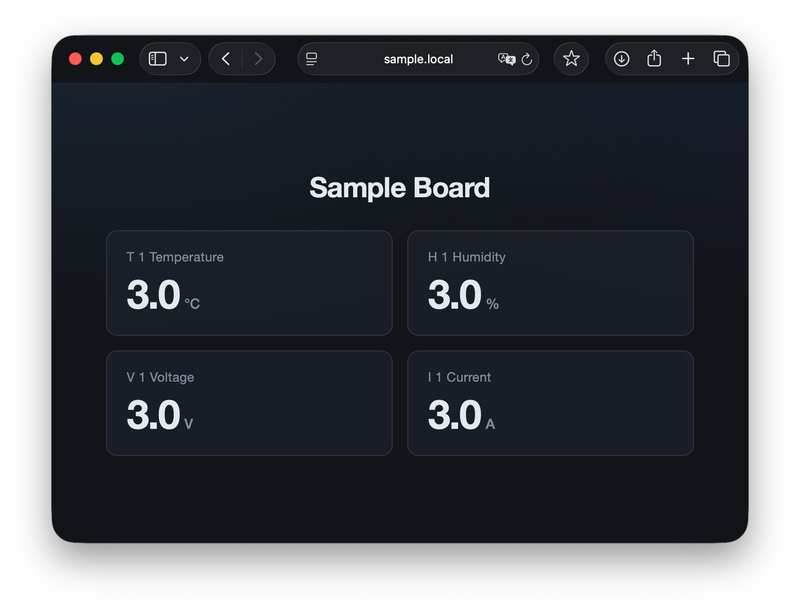

# idf-webpanel


A simple metrics panel for ESP-IDF.

## Quick start (`examples/panel`)

Build and flash `examples/panel` to run the sample dashboard.

### 1. Configure Wi-Fi in sdkconfig

Set the SSID and password via `protocol_examples_common`.

```bash
cd examples/panel
idf.py menuconfig
```

Configure these options:

- `Example Connection Configuration` → `WiFi SSID`
- `Example Connection Configuration` → `WiFi Password`

### 2. Build and start the ESP

```bash
idf.py set-target esp32   # change to match your target
idf.py build
idf.py -p PORT flash monitor
```

Replace `PORT` with your serial port (e.g. `/dev/ttyUSB0`, `/dev/cu.usbserial-*`).

After boot, the serial log shows Wi-Fi connection and mDNS readiness.

### 3. Open in a browser

From a PC or phone on the same network, open:

```
http://sample.local/
```

> **Note:** If mDNS (`.local`) is unavailable, use the IP address printed in the serial log instead.

## What the sample does

`examples/panel/main/main.cpp` declares the dashboard layout and feeds live values into it.

### Declarative UI

Define a `Board` with cards (id, title, unit, decimals):

```cpp
panel::Board s_panel = panel::Board{
    "Sample Board",
    {
        {"t_1", "T 1 Temperature", "°C", 1},
        {"h_1", "H 1 Humidity", "%", 1},
        {"v_1", "V 1 Voltage", "V", 1},
        {"i_1", "I 1 Current", "A", 1},
    },
};
```

### Updating values

Push new readings by card id (here, once per second with dummy values):

```cpp
s_panel.updateCard("t_1", static_cast<float>(tick % 100));
s_panel.updateCard("h_1", static_cast<float>(tick % 100));
s_panel.updateCard("v_1", static_cast<float>(tick % 100));
s_panel.updateCard("i_1", static_cast<float>(tick % 100));
```

`panel::init("sample", s_panel)` starts the HTTP server and mDNS at `http://sample.local/`.
